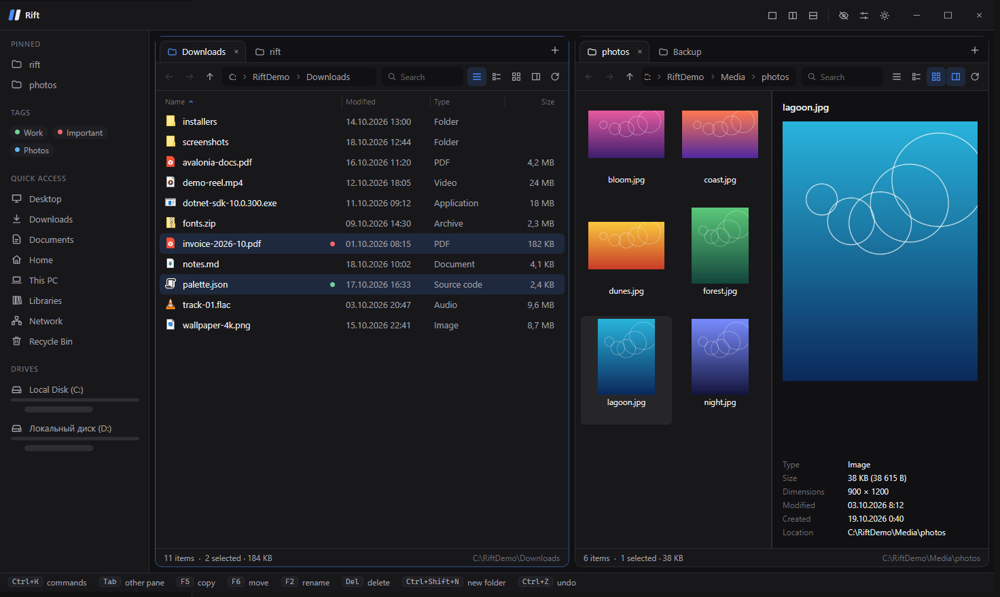
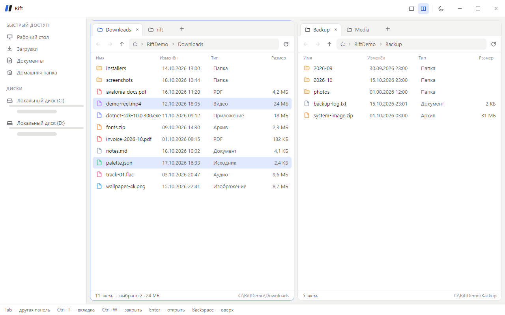

<p align="center">
  
</p>

<h1 align="center">Rift</h1>

<p align="center">
  A fast file manager for Windows with tabs and side-by-side panes.
</p>

<p align="center">
  <a href="https://github.com/keyldev/rift/actions/workflows/build.yml"></a>
  &nbsp;·&nbsp; English &nbsp;·&nbsp; <a href="README.ru.md">Русский</a>
</p>



<details>
<summary>Light theme</summary>



</details>

> Early stage. Rift already browses, copies and moves; next up are the right-click menu, system icons and search.
> See [ROADMAP.md](ROADMAP.md).

## Features

- Two panes side by side, each with its own tabs and history
- Copy and move between panes: F5 / F6, drag-n-drop, or Ctrl+C / Ctrl+V
- Drag files to and from Explorer, clipboard compatible with Explorer (including Cut)
- Operations panel with progress, pause and cancel; conflict dialog with "do this for all"
- Undo (Ctrl+Z) for copy, move, rename and new folder
- Delete to the Recycle Bin or permanently
- Inline rename, new folder
- Breadcrumbs, back / forward / up, quick access and drives in the sidebar
- Dark and light themes, custom title bar
- "Open in Rift" in Explorer's context menu
- English and Russian UI

## Download

Grab the latest build from the artifacts of the latest [CI run](https://github.com/keyldev/rift/actions/workflows/build.yml)
(`rift-win-x64`: a single `Rift.exe`, no .NET install needed).

## Keyboard

| Key | Action |
| --- | --- |
| Tab | Switch to the other pane |
| F5 / F6 | Copy / move selection to the other pane |
| Ctrl+C / Ctrl+X / Ctrl+V | Copy / cut / paste files (works with Explorer) |
| Del / Shift+Del | Move to Recycle Bin / delete permanently |
| F2 | Rename |
| Ctrl+Shift+N | New folder |
| Ctrl+Z | Undo |
| Ctrl+T / Ctrl+W | New tab / close tab |
| Enter, double click | Open |
| Backspace, Alt+↑ | Up |
| Alt+← / Alt+→ | Back / forward |
| Ctrl+R | Refresh |

Dragging: same drive moves, another drive copies; hold Ctrl to copy, Shift to move. Drop on a folder row to put files inside it.

## Command line

```bash
Rift.exe C:\Projects --right D:\Backup
```

- Every path opens as a tab; bare paths and `--left` go to the left pane, `--right` to the right one.
- `--lang en` or `--lang ru` overrides the UI language (by default Rift follows Windows).
- `--register-shell` / `--unregister-shell` add or remove "Open in Rift" in Explorer.

## "Open in Rift" in Explorer

Turn it on with the checkbox at the bottom of the sidebar, or run:

```bash
Rift.exe --register-shell
```

The item shows up for folders, empty space inside a folder and drives. It's written to `HKCU`, so no admin rights are needed.
On Windows 11 it's under "Show more options". The menu points to the `Rift.exe` it was enabled from, so re-enable it after moving the exe.

## Building

Needs the .NET 10 SDK.

```bash
dotnet run --project src/Rift.App
```

```bash
dotnet test
```

### Stack

- .NET 10, C#
- [Avalonia 12](https://avaloniaui.net/) + Fluent theme
- CommunityToolkit.Mvvm

### Layout

```
src/Rift.App     UI: windows, views, themes, view models
src/Rift.Core    logic without UI: folders, paths, history, file operations, undo, localization
src/Rift.Shell   Windows integration: Recycle Bin, clipboard, Explorer menu
tests/           Rift.Core tests
design/          interactive design mockup (React), open design/preview.html
scripts/         icon and demo files for screenshots
docs/            logo and screenshots
```

### Translations

UI strings live in `src/Rift.Core/Localization`: `Strings.resx` (English) and `Strings.ru.resx`.
To add a language, add `Strings.<culture>.resx` with the same keys and list the culture in `Strings.Supported`;
a test checks that every translation has every key.

### Screenshots and icon

Screenshots are taken on mock files, never on real folders:

```bash
powershell -File scripts/demo-fixture.ps1
```

```bash
dotnet run --project src/Rift.App -- --left C:\RiftDemo\Downloads --left C:\RiftDemo\Projects\rift --right C:\RiftDemo\Backup --right C:\RiftDemo\Media
```

```bash
powershell -File scripts/demo-fixture.ps1 -Remove
```

The app icon is generated by `python scripts/make-icon.py` (needs Pillow).

## License

[MIT](LICENSE)
